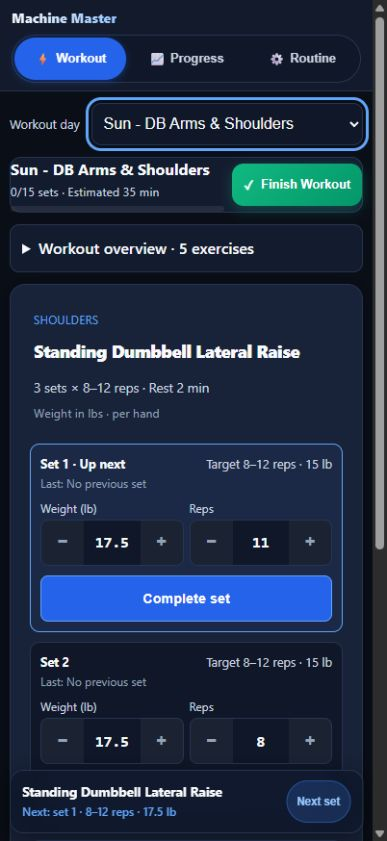
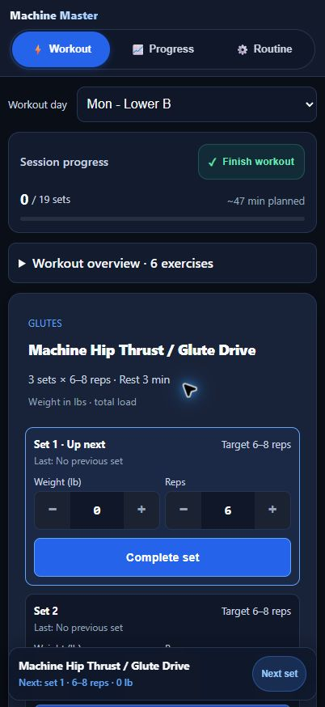
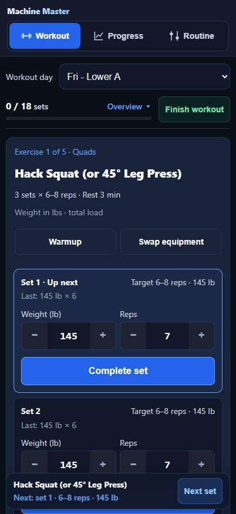
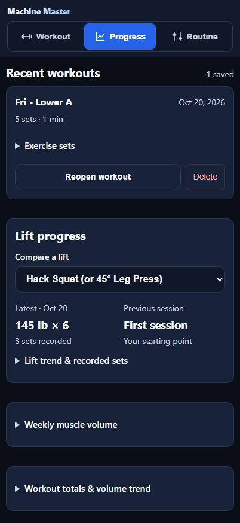
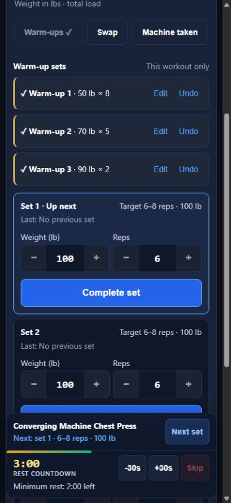
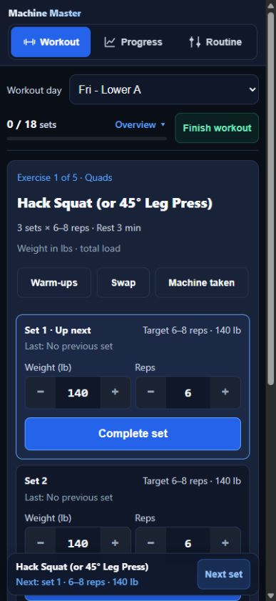
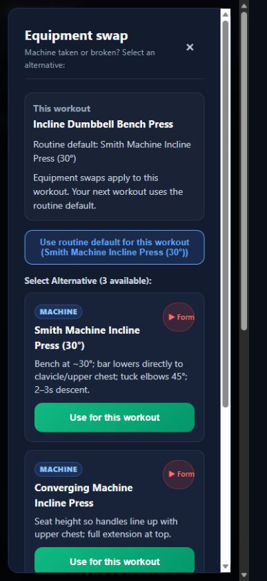
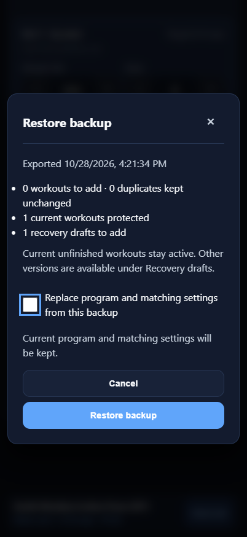
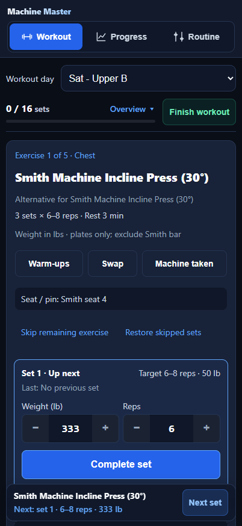
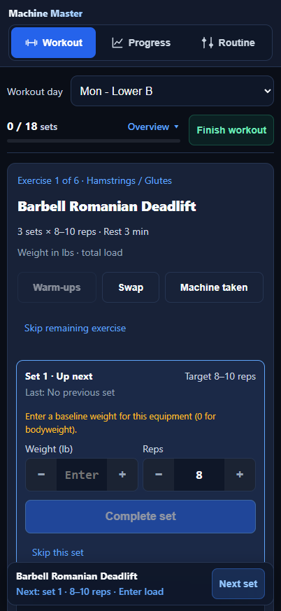

# Acceptance review

Reviewed 2026-10-19. Implementation delegated across workout logic, reporting/data, and mobile UI; integration reviewed separately.

## Preserved program

Automated comparison against the original routine confirms the five-day schedule, exercise names, prescribed sets and rep ranges are unchanged. Straight-set rests are at least 120 seconds and existing 180-second rests remain. Seated leg curl superset rest is 75 seconds; other supersets retain 60 seconds.

## Automated verification

Run `node --test tests/*.test.cjs` (32 tests). Coverage includes routine migration, alternating/uneven supersets, disabled supersets, minimum timer duration and restoration data, pending entries, equipment identity and baseline requirements, configurable increments, deload baseline protection, direct/indirect completed volume, transactional backup import and legacy compatibility, explicit updates, and offline shell handling.

Run `node --check` for app.js, routine-data.js, update-manager.js, accessibility.js and sw.js.

## Browser acceptance

Local responsive preview at 402 x 874: first set visible without scrolling, visible controls at least 44 pixels, pending weight/reps retained through reload. Widths 375, 390, 402 and 430 showed no horizontal overflow and visible input text was 16 pixels.

Confirmed three-minute hip thrust timer with early Skip disabled; final-set effort controls remain available until selected/skipped; Friday guidance alternates leg extension/curl and curl starts at 1:15. Changing increment to 2.5 updates stepper controls. Swap dialog focuses Close; Escape dismisses and restores focus to Swap equipment. Browser error/warning log was empty.

## Remaining device checks

Responsive browser testing does not validate physical iPhone Safari, home-screen installation, virtual keyboard behavior, VoiceOver, or sound/haptics while the phone is locked. Test these on the iPhone before relying on alerts. Service-worker lifecycle/offline behavior is covered by automated mocks; a real installed-PWA update/offline cycle remains a device acceptance check.

For local UI work, `python tests/preview_server.py` serves `/preview.html` without service-worker registration to avoid stale assets; `/index.html` serves the actual PWA.

## Header layout refinement (2026-10-20)

Replaced the crowded side-by-side day title/progress block with a padded session panel. Session progress and Finish workout share the first row; completed sets and planned duration sit above a full-width progress track. The workout name appears in the day picker, avoiding a duplicate heading. Finish uses a restrained green treatment so the current set remains the primary action.

Checked 375, 402, 430 and 1024 pixel widths: no horizontal overflow, a 44px Finish button, aligned panel edges, and a full-width track. At 402 x 874 the complete first set remains above the bottom dock. Completing a set updates the displayed count and progressbar value; Finish still opens the session summary. All 32 regression tests and JavaScript syntax checks pass. Physical iPhone verification remains outstanding.

## Workflow and design release v29 (2026-10-20)

Implemented all eight recommendations in design-use-audit-2026-10-20.md. The routine invariant test confirms the prescribed program is unchanged.

- Current set: compact completed rows retain Edit and unanswered effort controls. Next set reveals the actual row above the dock. Final-set effort remains available; a completed workout presents Review & finish.
- Finish: review and Keep training preserve the active session. Confirm archives once and stops rest. Short elapsed sessions show <1 min. Recoverable snapshots reopen through the summary or Progress; a newer progressed draft is protected.
- Resume: last progressed day resumes on reload. Stale sessions have dated Resume/Start new choices. Start new preserves the old draft; the overview offers restoration. Backups include retained drafts and the selected day, including incomplete invalid input. Storage-write failures roll back finish/reopen changes.
- Design: compact combined progress/overview, consistent SVG navigation icons, flatter surfaces, readable secondary text, and Warmup/Swap plus saved setup cues near the heading.
- Rest: visible minimum-rest countdown replaces reliance on hover explanations; original straight-set and superset timing rules remain.
- Progress/settings: recent saved workout first, latest/previous lift comparison, expandable detailed trends and muscle volume, concise program overview, named toggles, and clear Backup/Update controls.
- Validation: completed working sets require valid load and positive whole reps. Blank or invalid pending edits remain available to correct.

Validation: `node --test tests/*.test.cjs` passes all 45 tests; JavaScript syntax and diff checks pass. Browser acceptance at 402 x 874 covers actual next-set reveal, compact Edit/Done, blocked zero-rep edits, Keep training, Finish early, timer stop, Reopen, pending final effort, off-schedule reload, Start new/Restore, alternating supersets, 75-second curl rest, saved setup cues, and a full 15-set workout. Widths 375, 390, 402, 430 and 1024 showed no horizontal overflow or visible controls below 44px, with form text at least 16px. Browser error/warning log was empty.

Screenshots use local test data. Physical iPhone Safari keyboard, VoiceOver and locked-screen alerts remain device checks. No production deployment was performed for this release.

## Machine availability and inline warm-ups v30 (2026-10-21)

Implementation delegated to exercise-order and warm-up agents, followed by parent integration, an independent persistence/code review, and mobile browser acceptance.

- Machine taken moves the next unfinished exercise ahead of the current one, then returns after every remaining destination set. Enabled superset pairs move together. Repeated deferrals, partial sets, overview selections, running timers, and the final remaining group are covered.
- Warm-ups are editable card rows with Complete, Undo, Edit, and removal of unfinished rows. Suggestions use the current equipment load and configured increment. Duplicate ramps are prevented. Intermediate completion starts 90 seconds; the final remaining warm-up uses the exercise's regular rest. Browser verification on hack squat produced 1:30, 1:30, then 3:00.
- Warm-ups and order survive reload, retained drafts, backup/restore, and reopening a finished workout. New workouts reset both. Warm-ups remain outside working-set logs, progression, volume, previous working-set suggestions, and prescribed set counts. The original routine fixture remains unchanged.
- Review fixes cover restoring original equipment metadata, consistent warm-up numbering after removal/swaps, safe imported numbering, accessible edit focus/scrolling, and transactional rollback when warm-up/order storage fails. Backups add optional flow metadata in version 3.2 and continue accepting legacy files.

Validation: all 69 Node tests pass, JavaScript syntax checks pass, and git diff checks are clean. Responsive browser checks at 375, 390, 402, and 430 pixels found no horizontal overflow, visible buttons at least 44px high, and visible input text at least 16px. The parent verified deferral through all destination sets, paired movement, inline completion and validation, final-rest timing, reload recovery, and Start new/Restore draft. Browser warning/error logs were empty.

Screenshots use isolated local test data. Physical iPhone Safari, keyboard, VoiceOver, and locked-screen alerts remain device checks. Release assets are versioned together as v30; this change is pushed to a feature branch for deployment separately.

## Scheduled workout selection v31 (2026-10-21)

Replaced last-draft priority with the next local scheduled workout, skipping confirmed completions in the matching Monday–Sunday week. The schedule remains Wednesday, Friday, Saturday, Sunday, Monday. Missed days do not displace the next scheduled day, and a previous week's completion never skips a new week's occurrence.

An unfinished workout overrides the schedule only after actual activity today. The new optional lastInteractionAt timestamp records set/warm-up edits, completion, effort, exercise changes and deferrals. Passive saves, export/import and simply opening a day do not refresh it. Legacy drafts use start/completed-set timestamps instead of updatedAt. Explicit draft restoration/reopening records today's recovery action. Older drafts remain available through the picker and recovery controls.

The picker advances after successful finish, including Finish early. Foreground, pageshow and focus refresh the selection on a changed local date; same-date manual selections stay in place. Open dialogs defer the change. Explicit Resume/Keep training across midnight preserve the chosen workout for that date. Cross-day restore/reopen writes are atomic, and archived snapshot-only identities cannot revive completed drafts. Backup version 3.3 preserves optional activity timestamps; cached assets and the displayed build version are v31.

Validation: 94 Node tests pass, along with JavaScript syntax and git diff checks. Coverage includes every weekday, old Monday drafts with fresh automatic-save timestamps, today-only resume, completion/early completion, history ID/title compatibility, Sunday–Monday rollover, local midnight and both America/Chicago daylight-saving transitions, backup round trips, recovery, write rollback, and modal choices across midnight. Existing routine, machine deferral, warm-ups, rest and reporting tests also pass.

Responsive browser acceptance at 402 x 874 confirmed a fresh Wednesday selection; today's Wednesday draft survives reload; finishing Wednesday selects Friday and Friday survives another reload; reopening returns to Wednesday with logged values intact; actual off-schedule Monday edits resume after reload; Start new clears that activity and the next reload follows Friday. Browser warning/error logs were empty. The screenshot uses isolated test data. Physical iPhone Safari and device alerts remain device checks.

## Equipment defaults and recoverable swaps v32 (2026-10-23)

Restores legacy dumbbell replacements of Saturday's Smith incline press and machine overhead shoulder press to their original programmed defaults. The repair preserves prescribed sets, rep ranges, rest, order, and other exercises. Unknown custom lifts and future intentional default changes remain in place. Original routine fixtures are unchanged.

Equipment swaps use “Use for this workout” as the primary action. Future default changes sit inside a collapsed “Change routine default” section and require a separate review showing the old and new lift. Original lifts and prior defaults remain available as alternatives, including after repeated replacements. “Use routine default for this workout” and “Restore routine default” distinguish temporary restoration from changing future workouts.

The device-local repair is transactional with routine, revision, and affected draft writes. Untouched drafts receive targets from the restored lift's own history, requiring a baseline when none exists. Progressed and retained drafts keep equipment identity, weights, reps, warm-ups and timestamps; archived history is preserved. Reopened snapshots are reconciled on a clone so a Smith card cannot inherit dumbbell working loads. Backup imports retain original/alternative metadata and the repair marker; legacy backups can be repaired again. Promoting the currently selected temporary lift to a routine default retains its pending entries and warm-ups.

Browser acceptance on an isolated local origin verified Saturday's Smith incline and machine overhead prescriptions, temporary dumbbell use and reload recovery, the original Smith alternative and routine-default restore button, canceling the default review, deliberate replacement, restoring the original default through its separate review, and resetting temporary equipment in a new workout. Widths 375, 402 and 430 pixels showed no horizontal overflow, swap buttons at least 44px high, and numeric input text at 18px. Browser warning/error logs were empty. Tests use synthetic data; no phone workout data was read or changed.

Validation: all 119 Node tests pass, including 25 equipment-repair/swap regressions. JavaScript syntax checks and git diff checks pass. A pre-existing backup test now checks the restored day explicitly instead of assuming the scheduled picker selects Wednesday on every date.

Release assets and displayed build version are v32. This feature branch has not been deployed. Physical iPhone Safari, installed-PWA updates/offline, keyboard, VoiceOver and locked-screen alerts remain device checks.

## Everyday improvements v33 (2026-10-28)

Implemented equipment-specific setup memory, restore previews with protected active work, and reversible per-workout skips. Feature agents worked in isolated Git worktrees for setup and skipping; the coordinating agent integrated backup/recovery and reviewed the combined behavior. An independent persistence review added targeted regressions. The prescribed program and existing v32 repairs remain covered by the original fixture.

- Seat/pin settings follow effective equipment names across days and temporary/permanent swaps. Legacy slot settings require explicit adoption. Save failures retain the previous setting. Backups include the new equipment map.
- Restore preview stages validation, migration and all writes without changing data. Current progressed workouts, selection and running timer win by default; other versions remain selectable recovery entries. Restoring one retains the current progressed draft and other entries. Duplicate history and active/archive overlaps are handled without double counting. Unknown program days remain listed/exportable. Program/settings replacement is explicit. Downloads say requested rather than confirmed saved; imports do not update export status.
- Skip one working set or an exercise's remaining working sets/warm-ups. Superset partners continue, completed work remains intact, and Restore retains entered values. Counts distinguish completed/skipped/remaining; skipped work receives no volume, record or progression credit. Final completed-set effort remains available. Original set numbers survive gaps in history. Skips persist through reload, recovery, v3.4 backups and reopened snapshots; fresh workouts reset them. No empty saved workout is created.
- Integration regressions cover anonymous legacy IDs, reserved recovery prefixes, repeated imports, unsupported days, source equipment identity, normal versus deload baselines, stale previews, and transaction rollback including late equipment-repair writes. Backup formats 2.4, 3.2 and 3.3 remain accepted.

Validation: 164 Node tests pass; JavaScript syntax checks and git diff --check pass. Automated browser acceptance against the isolated preview at 375, 402 and 430 by 874 pixels passed setup adoption/swaps, skip/reload/restore, backup preview/cancel/protected import, multiple draft recovery, and independent superset skipping. No horizontal overflow, visible buttons below 44px or visible form text below 16px; browser error/warning logs were empty. Modal keyboard focus remained within the open dialog. Screenshots contain synthetic data.

Run node --test tests/*.test.cjs and the five node --check commands from package.json. For browser checks, start python tests/preview_server.py and run node tests/browser-everyday.cjs with Playwright available (PLAYWRIGHT_MODULE can select the bundled module; CHROME_EXECUTABLE can select an installed browser). PREVIEW_URL optionally overrides the local preview address.

Release assets and displayed build are v33. This is a tested local feature branch; no push, merge or deployment was performed. Physical iPhone Safari keyboard, VoiceOver, installed-PWA update/offline cycles and locked-screen alerts remain unverified device checks.

## Approved Monday routine revision v34 (2026-10-30)

Monday Lower B now uses Barbell Romanian Deadlift, 3 x 8-10 with 180-second rest; Seated Hip Abduction (knees outward), 2 x 12-20 with 120-second rest; and Machine Crunch, 3 x 10-12 with 120-second rest. These replace hip thrust, 45-degree back extension, and captain's chair respectively. RDL notes advise two working sets for the first couple of sessions (remove one through existing exercise options), then three, with 2-3 reps in reserve and the bar included in total load. The leg press/calf pairing, lying curl, all other days and Friday's 4 x 8-12 leg extensions are preserved. Monday has 18 planned working sets; the weekly plan has 10 primary quad sets, 10 hamstring sets and 6 core sets, with hip-abduction work recorded under glutes.

New equipment requires its own starting load unless its own prior history exists. Stable routine slot IDs keep old records addressable. A one-time per-slot Monday revision updates recognized defaults and preserves custom replacements or modified prescriptions. Saturday and Monday upgrades share the existing atomic startup/restore transaction. Unedited active drafts regenerate the correct row counts and new baselines; progressed, legacy and recovery drafts retain rows, skips, warm-ups, equipment and activity times. Fresh workouts receive the new routine. Archived records remain untouched; reopening reconciles a clone. Backup restore normalizes program revisions before deduplication and preserves retained drafts in either program-restore mode.

Preserved old/custom equipment carries its original prescribed set count so two completed back-extension sets plus a skipped third cannot unlock progression through the new abduction two-set threshold. Equipment changes clear stale pending prescription metadata while completed rows retain it. Historical lifts remain recognized in volume reporting. The original program fixture is retained; its acceptance check permits exactly the three authorized Monday differences.

Validation: 183 Node tests pass (19 focused Monday migration regressions plus all 164 prior tests). All five JavaScript syntax checks and git diff --check pass. An independent agent reviewed persistence and wrote migration tests; parent integrated fixes and browser acceptance. Tests include custom defaults, repeated loads/imports, own-equipment baselines, unedited/current/legacy/recovery drafts, mixed equipment, archived clone reopen, storage rollback, both backup modes and progression across swaps.

Synthetic browser acceptance at 375/402/430 x 874 confirms fresh prescriptions/counts and required load entry; RDL completion starts 180-second rest; reload recovery; old unedited/progressed migration; correct new workout reset; unchanged Friday extensions; no overflow, visible buttons under 44px or visible form text under 16px; no browser warnings/errors. The existing everyday-flow browser script also passes at all three widths, including setup, swaps, skipping and protected backup recovery.

Run python tests/preview_server.py, then node tests/browser-monday.cjs with Playwright available (PLAYWRIGHT_MODULE and CHROME_EXECUTABLE can select local runtime paths). Screenshots use synthetic data. Release assets and displayed build are v34. This implementation is a local feature branch; no push, merge or deployment was performed for v34. Physical iPhone keyboard, VoiceOver and installed-PWA update/offline checks remain device acceptance work.

