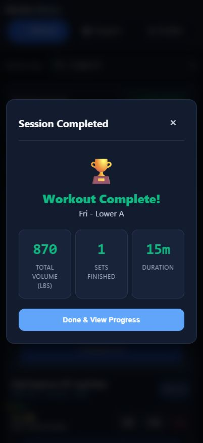
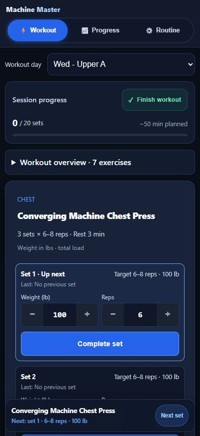

# Design and use audit - 2026-10-20

Scope: deployed v28, mobile interaction and visual design. Training program excluded. Live site viewed at 402 x 874; mutation flows reproduced against the same release on localhost with test data. This is a browser audit, not physical iPhone Safari/VoiceOver/keyboard verification.

## Recommended order

### 1. Make Next set reveal the next set (high)

Observed: after completing sets 1 and 2 and pressing Next set, set 3 began at y=861 in an 874px viewport; the rest dock began at y=735. The action scrolls to the exercise card heading, leaving the actual next input out of usable view. Completed sets retain their entire input block and effort selectors.

Change: collapse completed sets to a one-line result with Edit; preserve an unanswered effort prompt until selected/skipped. Scroll the actual next unfinished set above the dock. Avoid moving the screen while an input is being edited.

Acceptance: after completing or navigating to any set, its inputs and Complete action are visible above the dock, including later sets and superset partners. Completed rows remain editable.

Evidence: app.js jumpToActiveExercise around line 1325; renderExerciseCard around line 957; browser reproduction.

### 2. Review before finishing and allow recovery (high)

Observed: Finish after 1 of 18 sets immediately wrote history and reset the active workout. The summary offered only Close and Done & View Progress. The rest timer continued. A session lasting seconds displayed 15m because of the duration fallback.

Change: show a review with completed/remaining sets, Keep training, and Finish early when incomplete. Provide a way to reopen an accidentally finished session. Stop its timer on successful finish. Display actual elapsed time or an explicitly labelled estimate.

Acceptance: opening the finish review does not reset or archive the session; cancelling preserves edits; confirming saves once and stops rest. Very short workouts do not display an invented 15 minutes.

Evidence: app.js showWorkoutSummary around lines 2031-2172; isolated browser reproduction.

### 3. Resume the selected session on reopen (high)

Observed: selected Friday, entered 145 lb, reloaded; the app opened Wednesday. Returning manually to Friday restored 145 lb, so persistence worked but orientation did not.

Change: persist the last active day/session and show Resume workout with a date. When no workout is in progress, suggest the scheduled/upcoming day. Make Start new distinct from Resume, particularly for sessions left unfinished overnight.

Acceptance: reopening an in-progress off-schedule workout returns to its selected day and next unfinished set; stored older sessions are clearly dated.

Evidence: constructor activeDayIndex and getSuggestedDayIndex around lines 38 and 565; browser reproduction.

### 4. Reduce the space before the working set (medium, design)

Observed: first set started around y=528 at 402 x 874; the first weight/reps inputs are lower still. Brand/navigation, day picker, progress panel, overview and exercise header occupy most of the first screen. The dock repeats the current exercise/target.

Change: retain the improved padding, but combine session progress and overview into a compact expandable summary. Show Exercise 1 of 6 alongside its name. Keep the current set dominant and use the dock primarily for rest and navigation when needed. Use a consistent icon family and flatter treatments rather than additional gradients, outlines and nested cards.

Acceptance: first-set controls are comfortably visible with phone safe areas, and active logging shows the current set plus useful nearby context. No new small touch targets.

### 5. Put setup tools before the work (medium, design)

Observed: Setup, notes & exercise options began around y=1148, below all three set blocks. Warmup, Swap equipment, seat/pin and notes are all inside that disclosure.

Change: put Warmup and Swap beside the exercise heading or in a clearly named menu there. Show a saved seat/pin or short setup note immediately under the name. Keep increments, load convention and set-count adjustments in the secondary disclosure.

Acceptance: warmup and equipment swap are reachable before scrolling through sets; existing setup information is visible before logging.

### 6. Make the rest state self-explanatory (medium)

Observed: the countdown is clear, but an early disabled Skip is explained only by a title/tooltip. That explanation is difficult to discover on touch. The large combined dock reduces usable space as completed rows grow.

Change: show a short visible minimum-rest status or countdown until Skip is available. Keep a compact timer and specific next-set label. Preserve the existing two-minute straight-set minimum and configured longer rests.

Acceptance: without hovering, the user can tell why Skip is disabled and when it becomes available. No shortened straight-set rests.

### 7. Put useful progress and settings first (medium, design)

Observed: Progress leads with lifetime workout count, lifetime volume and a static 5-Day tile. Full workout history sits below exercise details and a 13-row muscle table. Routine combines long day descriptions with backups, app updates, wake lock and sound testing.

Change: lead Progress with recent workouts and the selected lift's last-session comparison; keep muscle volume expandable. Separate program overview from Settings & backup, with clear sections and recent backup status. Use plain labels such as Backup instead of Data Shield.

Acceptance: the last saved workout and a familiar lift comparison are available without scrolling past the muscle table; backup and update controls are easy to locate.

### 8. Tighten input and accessibility details (medium)

Observed: a set with zero reps could be marked completed and increased the workout set count. The exercise picker in Progress has no accessible label and uses 14.72px text. The two settings toggles have visually adjacent text, but their wrapping labels contain no text and there are no aria labels. Previous-set text is 12px; load convention is 12.48px.

Change: require positive whole reps for a completed working set, or provide a distinct skipped/failed attempt action. Add descriptive labels to the picker and toggles; use 16px form controls throughout and increase important secondary text to approximately 14px. Verify focus and announcements on the actual iPhone.

Acceptance: zero-rep attempts do not count as completed working sets by accident; VoiceOver identifies every setting/control; essential last-set information is readable during a workout.

## Overall assessment

The input controls, load labels, saved pending entries, and cleaner session panel are useful foundations. The next pass should prioritize resuming, moving between sets, and safely finishing, followed by a single cohesive visual pass. No training-program changes are needed for these improvements. No production code was modified during this audit.
